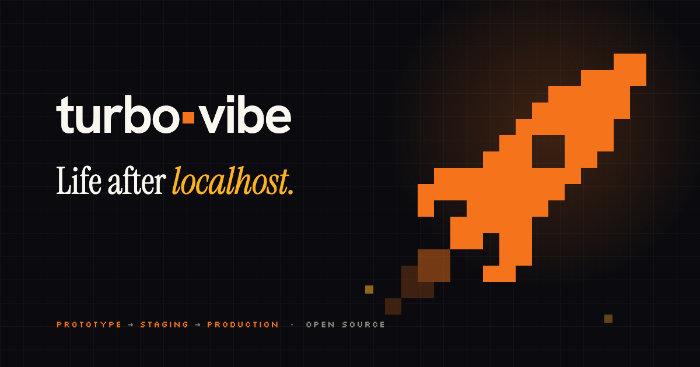
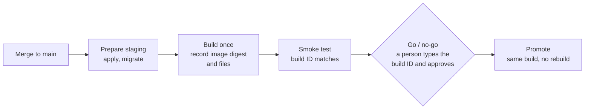

<p align="center">
  
</p>

<p align="center"><strong>From prototype to production in an afternoon.</strong></p>

<p align="center">
  <a href="https://www.npmjs.com/package/@turbo-vibe/cli"></a>
  <a href="https://github.com/dannycalleri/turbo-vibe/actions/workflows/pipeline.yml"></a>
  <a href="https://github.com/dannycalleri/turbo-vibe/actions/workflows/live-tests.yml"></a>
  <a href="https://www.npmjs.com/package/@turbo-vibe/cli"></a>
  
  <a href="LICENSE"></a>
</p>

<p align="center">
  <a href="#get-started">Get started</a> ·
  <a href="docs/adoption.md">Adoption guide</a> ·
  <a href="docs/file-format.md">File format</a> ·
  <a href="docs/reference.md">Reference</a> ·
  <a href="#examples">Examples</a> ·
  <a href="COMPATIBILITY.md">Compatibility</a>
</p>

You built it in a weekend. Shipping it shouldn't take a month. From one file, turbo-vibe gives your app staging and production in your own Cloudflare, Vercel, Supabase and WorkOS accounts. It ships the build that passed staging only when you say so.

## Get started

```sh
npx @turbo-vibe/cli@1 init    # 1. Describe it: arrow-key choices, defaults read from your repository → turbo-vibe.yaml and two workflows
npx @turbo-vibe/cli@1 setup   # 2. Connect your accounts: one guided step per vendor, each token checked as you paste it
git push origin main          # 3. Merge: every merge deploys to staging and is smoke-tested
```

`init` ends by offering to run `setup` for you. To go live, run **Deploy to production** from the Actions tab, type the build ID and approve.

**Have an app already?** Run `npx @turbo-vibe/cli@1 adopt` in your repository and ask your coding agent to make it deployable. It adapts the backend, runs step 1 and opens a pull request. Step 2 stays with you. The [adoption guide](docs/adoption.md) covers the same path by hand.

You need Node 24, [OpenTofu](https://opentofu.org/docs/intro/install/) 1.10 or later as `tofu`, Docker, a signed-in [GitHub CLI](https://cli.github.com), and the accounts in the [bootstrap checklist](docs/bootstrap.md). `setup --list` prints the ones your file needs.

## How a release works

**Built once. Tested on staging. Promoted by you.**



1. **Merge.** A pull request merges to `main`, and the Staging workflow starts.
2. **Prepare staging.** Staging's infrastructure is applied and its database migrated before any new code goes live.
3. **Build once.** The backend becomes a container image and the frontend its build output. Both go to staging, and the image digest and the files are recorded in your bucket.
4. **Smoke test.** Staging must answer with the build that was just deployed, or the release stops here.
5. **Go / no-go.** A person runs **Deploy to production** and types the build ID. With a required reviewer, they approve it too.
6. **Promote.** Production is applied and migrated, then receives the same artifacts unchanged and gets the same smoke test.

## What you get

| | |
|---|---|
| **Two copies, one build.** | Staging and production each get their own database, sign-in settings and hostname, from the same yaml. Both run the same build. |
| **Secrets stay secret.** | `setup` reads each token and each of your app's secrets without echo and hands it straight to GitHub. A value never reaches the disk, a command line or a log. Frontend builds see none of turbo-vibe's credentials. |
| **Production gets the build you tested.** | Promotion ships the recorded image digest and files, with production's own public values (such as `NEXT_PUBLIC_*` keys) put in place of staging's. Nothing is rebuilt. |
| **Schema changes go first.** | Migrations run before the new code goes live. The running app gets a database role that can write rows but cannot change the schema. |
| **No surprise deletions.** | `plan --env` shows what would be created, changed, replaced or deleted, per service. `apply` refuses deletions unless you pass `--allow-deletions`. |
| **Know what's missing first.** | `check` lists every missing permission, token or tool, each with its fix. |
| **A preview per pull request.** | With `previews: true`, each pull request gets its own environment, its URLs posted as a comment, removed on close. Previews are never promotable, and forks get no secrets. |

## Ship it with your agent

Built it with an agent? Ship it with one. `adopt` teaches Claude Code or Cursor how to adapt the project, walk you through the accounts, and make every change after. The agent edits code and config. Secrets and the production deploy stay with you.

```sh
npx @turbo-vibe/cli@1 adopt                 # for a project that doesn't use turbo-vibe yet
npx @turbo-vibe/cli@1 init --only-assistant # guidance for everyday changes in a project that does
```

## The file

```yaml
# yaml-language-server: $schema=https://unpkg.com/@turbo-vibe/cli@1/schema/turbo-vibe.schema.json
version: 1
project: myapp
domain: myapp.example.com
services:
  api:
    kind: backend
    target: cloudflare-container
    build: { dockerfile: Dockerfile, test: go test ./... }
    secrets: [STRIPE_SECRET_KEY]
  web:
    kind: frontend
    target: cloudflare-static
    serve_with: api            # one Worker: the page at /, the API at /api/
    build: { command: npm ci && npm run build, output: dist }
  db:
    kind: database
    target: supabase
    region: eu-central-1
  auth:
    kind: identity
    target: workos
```

| Kind | Targets |
|---|---|
| `backend` | `cloudflare-container` |
| `frontend` | `cloudflare-static`, `vercel-static` (beta), `vercel-nextjs` (beta) |
| `database` | `supabase`, a project per environment |
| `identity` | `workos`, sign-in per environment |

`cloudflare-static` runs on Workers Static Assets, which Cloudflare recommends instead of Pages for new projects. With `serve_with`, the page and the API share one Worker and one origin, so the page calls the API without CORS and the sign-in cookie reaches it. Every field is in the [file format](docs/file-format.md). [COMPATIBILITY.md](COMPATIBILITY.md) lists the versions each target pins and the date it last passed a live run.

## Commands

The reusable workflows run these for you. Each one also runs from a terminal, validates the file before anything external runs, and prints names, never secret values.

| Command | What it does |
|---|---|
| `init` | Writes `turbo-vibe.yaml` and the staging and production workflows. |
| `adopt` | Teaches your coding agent to adapt an existing project. |
| `setup` | Creates the GitHub environments and stores every secret. `--list` prints what a person must do first. |
| `check --env <env>` | Lists each missing account, token or tool, with its fix. |
| `plan [--env <env>]` | What each environment runs, or what applying it would change. |
| `apply --env <env>` | Creates or updates the infrastructure with OpenTofu. |
| `migrate --env <env>` | Applies pending database migrations. |
| `test`, `deploy`, `smoke` | Tests, builds and ships each service, then checks it serves the build. |
| `promote --env production` | Ships the latest staging build that passed, without rebuilding it. |
| `preview deploy`, `preview remove` | A pull request's own environment. |

[Commands in detail](docs/reference.md#commands-in-detail) · [Build once, promote the same build](docs/reference.md#build-once-promote-the-same-build) · [Deploy to production](docs/reference.md#deploy-to-production) · [Previews](docs/reference.md#previews) · [What a backend must do](docs/reference.md#what-a-backend-must-do) · [Your application's own secrets](docs/reference.md#your-applications-own-secrets) · [Credentials](docs/reference.md#credentials)

## Examples

Each walkthrough goes from `init` to production.

| Example | What it shows |
|---|---|
| [`go-api`](examples/go-api/README.md) | A Go API and a static page from one Worker, a Supabase database with a migration, and sign-in with WorkOS AuthKit. |
| [`python-api`](examples/python-api/README.md) | A standard-library Python API that routes `?session=` to its own container instance. |
| [`nextjs`](examples/nextjs/README.md) | A Next.js app with a server-rendered page on Vercel (beta). |
| [`vercel-static`](examples/vercel-static/) | A static page on Vercel (beta) against the Go API on Cloudflare. |

## All of it stays yours

One file wires it all up, and every resource lives in your own accounts:

- **Your accounts.** Workers, databases, sign-in and DNS are created in your accounts, with OpenTofu state in your own bucket. Vendors bill you directly.
- **Your config.** `turbo-vibe.yaml` and the workflows are plain files in your repository, reviewed and versioned like code.
- **Your call.** Stay because it saves you work, not because you are stuck. Remove the yaml and its workflows, and your services keep running.

Moving to another host is a different question: see [Moving between hosts](docs/reference.md#moving-between-hosts).

## Contributing

```sh
pnpm install
make check         # biome ci, tsc --noEmit, vitest run: the gate for every commit
make integration   # OpenTofu validation, workflow lint, real Postgres, dry runs of the examples; needs Docker
```

Commits follow Conventional Commits. Direct dependencies are pinned to exact versions, and workflow actions by commit SHA.

## License

[MIT](LICENSE)
