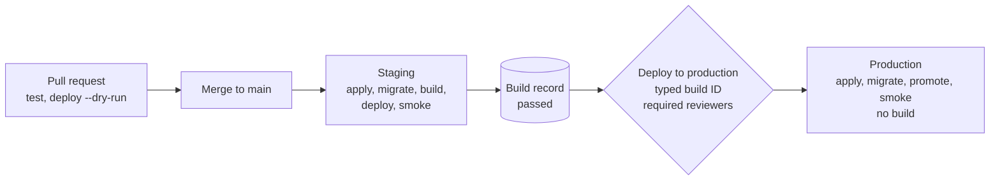

<h1 align="center">turbo-vibe</h1>

<p align="center"><strong>The production step after the prototype.</strong></p>

<p align="center">
  <a href="docs/adoption.md">Adoption guide</a> ·
  <a href="docs/bootstrap.md">Bootstrap checklist</a> ·
  <a href="docs/file-format.md">File format</a> ·
  <a href="#examples">Examples</a> ·
  <a href="COMPATIBILITY.md">Compatibility</a>
</p>

turbo-vibe takes an app that works on your laptop and runs it for real users. One `turbo-vibe.yaml` describes the services: a backend, a frontend, a database, sign-in. Every merge deploys to staging and is smoke-tested. A person promotes the exact build that passed staging to production. Nothing is rebuilt on the way, and everything runs in your own Cloudflare, Vercel, Supabase and WorkOS accounts.

## Quickstart

```sh
npx @turbo-vibe/cli@1 init    # a few answers → turbo-vibe.yaml and two workflows
npx @turbo-vibe/cli@1 plan    # what each environment would run, from the file alone
npx @turbo-vibe/cli@1 setup   # GitHub environments and secrets, from one bootstrap token
git push origin main          # Staging: test, apply, migrate, build, deploy, smoke
```

Then run **Deploy to production** from the Actions tab, type the build ID the Staging run printed, and approve it. Production receives the image digest and files that staging tested.

You need Node 24, [OpenTofu](https://opentofu.org/docs/intro/install/) 1.10 or later on `PATH` as `tofu`, Docker for `deploy`, a signed-in [GitHub CLI](https://cli.github.com) for `setup`, and the accounts and tokens from the [bootstrap checklist](docs/bootstrap.md); `setup --list` prints the ones your file needs. To add the kit to an existing repository, follow the [adoption guide](docs/adoption.md).

## What you get

- **One file.** `turbo-vibe.yaml` names each service, its target and how to build it. Every field is in the [file format](docs/file-format.md), and the JSON Schema ships in the package for editor completion.
- **Staging on every merge.** The reusable `deploy.yml` workflow tests, applies the infrastructure, migrates the database, builds, deploys and smoke-tests. Pull requests run the test-and-build job with no secrets.
- **Build once, promote the same build.** Staging records the image digest and the built files. Promotion ships that record. Nothing is built again. [Details.](#build-once-promote-the-same-build)
- **Two safeguards before production.** The run asks for the build ID, typed, and waits for the `production` environment's required reviewers where GitHub offers them. [Details.](#deploy-to-production)
- **No unrequested deletions.** `plan --env` shows what applying would create, change, replace or delete, per service. `apply` refuses a plan that deletes or replaces a resource unless given `--allow-deletions`.
- **A preview per pull request.** With `previews: true`, the reusable `preview.yml` workflow deploys each pull request to its own environment and removes it on close. [Details.](#previews)
- **Setup from one token.** `setup` creates the GitHub environments, the Cloudflare zone, one state bucket per environment and each environment's tokens from one short-lived bootstrap token, and stores every secret without echoing it.
- **Nothing to leave.** Every resource lives in your own accounts. To stop using the kit, delete `turbo-vibe.yaml` and its workflows. [What you are locked into.](#what-you-are-locked-into)
- **Coding assistants kept in their lane.** `init --assistant` writes guidance that teaches an assistant to change infrastructure only through the file, to show `plan --env` first, and to leave `setup` and promotion to a person. [Details.](#coding-assistants)

## How it works



Each environment is a copy of the app with its own database, sign-in settings and address. Staging's `deploy` builds every service once and records what it shipped in staging's state bucket, which production can read but never change. `smoke` asks each service for its build ID and marks the record `passed` or `failed`. **Deploy to production** checks out that build's commit, applies production's infrastructure, migrates, promotes the recorded outputs, and smoke-tests again. A build that failed on staging can never be promoted.

Long-lived resources (Workers, routes, DNS, Supabase projects, Vercel projects, WorkOS redirect URIs) are OpenTofu modules shipped in the package, with state in your R2 bucket. `wrangler` and the Vercel CLI ship the code.

## The file

```yaml
# yaml-language-server: $schema=https://unpkg.com/@turbo-vibe/cli@1/schema/turbo-vibe.schema.json
version: 1
project: myapp
domain: myapp.example.com
environments:
  staging: { hostname: staging-myapp.example.com }   # one level below the zone
services:
  api:
    kind: backend
    target: cloudflare-container
    build: { dockerfile: Dockerfile, test: go test ./... }
  web:
    kind: frontend
    target: cloudflare-static
    serve_with: api            # one Worker: the page at /, the API at /api/
    build: { command: npm ci && npm run build, output: dist }
  db:
    kind: database
    target: supabase
    region: eu-central-1
  auth:
    kind: identity
    target: workos
```

A backend is served under `/api/` and a frontend under `/`. One target per service:

| Kind | Target | Stability |
|---|---|---|
| `backend` | `cloudflare-container` | stable |
| `frontend` | `cloudflare-static` | stable |
| `frontend` | `vercel-static` | beta |
| `frontend` | `vercel-nextjs` | beta |
| `database` | `supabase` | stable |
| `identity` | `workos` | stable |

Targets marked **beta** are supported and tested on every change, with less history in live runs than the others. [COMPATIBILITY.md](COMPATIBILITY.md) lists, for each adapter, the tool and provider versions this release pins and the last date it passed a live run.

## Commands

The reusable workflows run these for you. Each one also runs from a terminal.

| Command | What it does |
|---|---|
| `init` | Writes `turbo-vibe.yaml` and the staging and production workflows from a few answers. |
| `adopt` | Writes guidance that lets a coding assistant adapt an existing project to turbo-vibe and check it locally. |
| `plan` | Lists the services each environment runs and where, from the file alone. |
| `plan --env <env>` | Asks OpenTofu what applying that environment would create, change, replace or delete, per service. Changes nothing. |
| `setup` | Creates the GitHub environments and stores every secret each one needs. `setup --list` prints what a person must do first. |
| `check --env <env>` | Verifies an environment's accounts, tokens and tools, and lists each problem with its fix. |
| `test` | Runs each service's test command. |
| `apply --env <env>` | Creates or updates an environment's infrastructure with OpenTofu. |
| `migrate --env <env>` | Creates the database roles and applies pending migrations. |
| `deploy --env <env> --build-id <id>` | Builds each service and ships it. `--dry-run` builds and validates without credentials. |
| `smoke --env <env> --build-id <id>` | Checks that every service reports that build ID. |
| `promote --env production` | Deploys the latest staging build that passed, without rebuilding it. |
| `preview deploy`, `preview remove` | Deploys or removes a pull request branch's preview environment. |

Every command validates the file before anything external runs, prints resource names and never secret values, and exits non-zero on a problem. `.turbo-vibe/` holds the working files of `apply` and `deploy`; add it to `.gitignore`.

<details>
<summary><strong>What each command does, in detail</strong></summary>

**`init`** asks for the project's name, domain, and the target of each service, then writes `turbo-vibe.yaml` and the staging and production workflows. It never replaces existing files unless given `--force`. Every answer has a flag (`--name`, `--domain`, `--backend`, `--frontend`, `--database`, `--identity`, `--assistant`) for running it non-interactively. It treats a two-label domain (`example.com`) as the zone apex and anything longer as one level below the zone. For a domain on a multi-part suffix, such as `example.co.uk`, edit the hostnames it writes. Build commands, output directories and the Supabase region it fills in are marked as defaults to replace.

**`adopt`** writes guidance for a coding assistant (`--assistant claude`, `cursor` or `both`) into an existing repository, which needs no `turbo-vibe.yaml` yet. Asked to make the project deployable with turbo-vibe, the assistant inspects the repository, maps each part to a target or names what turbo-vibe cannot run yet, changes the backend to the contract in [What a backend must do](#what-a-backend-must-do), writes the config and workflows with `init`, checks them with `plan`, `test` and `deploy --dry-run`, and leaves account setup and production to you. It never replaces existing files unless given `--force`.

**`plan`** lists the services each environment runs and where, from the file alone. `plan --env <env>` asks OpenTofu what applying that environment would do and prints it per service: what it would create, change, replace or delete, with deletions and replacements listed apart. It prints resource addresses and actions only, never values, and changes nothing.

**`setup`** creates the GitHub environments `staging` and `production`, and `preview` when the config enables previews. It limits `staging` and `production` to `main` and adds you as a required reviewer on `production`, where GitHub offers these rules. It stores every secret each environment needs. From one Cloudflare bootstrap token, it finds or creates the zone and one state bucket per environment, and creates each environment's CI and R2 tokens. Each R2 token reaches only its environment's bucket; production's can also read staging's, to promote its builds. It finds the Supabase organization and the Vercel team from their tokens, and asks for the rest. It needs a terminal and a signed-in [GitHub CLI](https://cli.github.com): it reads each value without echoing it and gives it to `gh secret set` on standard input, so a value never reaches the disk, a command line or the output. A second run keeps what each environment already has. `--replace <SECRET>` asks for a secret again and creates its Cloudflare token again, and `--env <name>` sets up other environments, such as `live`, like `staging`. It ends with the checks that `check` runs. `setup --list` prints, from the file alone, the accounts, plans and steps a person must do first, and the secrets each environment will get; it changes nothing.

**`check`** verifies an environment's accounts, tokens, and tools for the targets the project uses, and changes nothing. It lists every problem with its fix, and exits non-zero until the environment is ready.

**`apply`** writes the environment's OpenTofu root, saves a plan, prints its summary, and applies that plan. It refuses a plan that deletes or replaces a resource outside a preview unless given `--allow-deletions` (the reusable workflows' `allow-deletions` input).

**`deploy --dry-run`** builds everything and validates the Worker without credentials. It starts each backend image, and fails unless the container answers `/api/health` with the build ID and stops on `SIGTERM`. `deploy --env production` is refused, so production only ever runs promoted builds.

**`promote --choose`** prints the build it would promote and changes nothing. `promote --build-id <id>` promotes exactly that build, and refuses it unless it passed on staging. `promote --confirm <id>` refuses unless `<id>` is the build it would choose.

</details>

## Examples

Each walkthrough goes from `init` to production step by step.

| Example | What it shows |
|---|---|
| [`go-api`](examples/go-api/README.md) | A Go API and a static page from one Worker, a Supabase database with a migration, and sign-in with WorkOS AuthKit. |
| [`python-api`](examples/python-api/README.md) | A standard-library Python API that routes `?session=` to its own container instance. |
| [`nextjs`](examples/nextjs/README.md) | A Next.js app with a server-rendered page on Vercel (beta). |
| [`vercel-static`](examples/vercel-static/) | A static page on Vercel (beta) against the Go API on Cloudflare. |

## What you are locked into

Nothing that turbo-vibe owns. Every resource lives in your own vendor accounts, and the OpenTofu state and build records live in your own bucket. To stop using the kit, delete `turbo-vibe.yaml` and its workflows; your services keep running where they are.

Moving between vendors is a different question. The kit sets up each host the same way, but a move is still work:

| Part of the app | What moving it takes |
|---|---|
| A static frontend | Possible between `cloudflare-static` and `vercel-static` (beta), with work. On Vercel the page and the API have different origins, so: change `target` and remove `serve_with`; set `api_hostname` where `api.<hostname>` would be two levels below the zone; make the backend accept only `ALLOWED_ORIGINS`; and have the page read its API URL from `/_turbo-vibe/config.json`. See [Static frontends on Vercel](#static-frontends-on-vercel-beta). Moving back means adding `serve_with` again. |
| A Next.js frontend | Not through the kit: `vercel-nextjs` (beta) is its only target. |
| A backend container | Not through the kit yet: `cloudflare-container` is its only target. The image is built from your own Dockerfile and runs on any container host, given `BUILD_ID` as a build argument and, at runtime, `PORT`, `DATABASE_URL` and the sign-in and origin settings. If it sets `container.instance_from`, the new host must route those requests to the same instance itself. |
| Database data | No. Moving a Supabase database's data to another provider is your own migration. |
| Signed-in users | No. Users and their sessions stay in WorkOS. |

## Reference

- [Build once, promote the same build](#build-once-promote-the-same-build)
- [Deploy to production](#deploy-to-production)
- [Previews](#previews)
- [What a backend must do](#what-a-backend-must-do)
- [Sessions on their own container](#sessions-on-their-own-container)
- [Databases](#databases)
- [Sign-in](#sign-in)
- [Static frontends on Vercel (beta)](#static-frontends-on-vercel-beta)
- [Next.js on Vercel (beta)](#nextjs-on-vercel-beta)
- [Credentials](#credentials)
- [Actions minutes per run](#actions-minutes-per-run)
- [Coding assistants](#coding-assistants)

### Build once, promote the same build

A staging `deploy` builds every service once and records what it shipped in staging's state bucket, at `<project>/builds/<build id>.json`. Production reads those records from there and cannot change them:

- the container image's registry digest (`docker build`, then `wrangler containers push`);
- an archive of each static frontend's built files, with a placeholder where each [public value](#public-values-in-a-frontend-build) goes.

`smoke --env staging` marks that record `passed` or `failed`.

`promote --env production` picks the newest staging build that passed. Newer failed or unchecked builds are skipped. It deploys only that build's recorded outputs: the same image digest, and the same files unpacked from the archive. Nothing is built again. With no passing build, it stops before changing anything. `promote --choose` prints the build it would promote and changes nothing. `promote --build-id <id>` promotes exactly that build, and refuses it unless it passed on staging. Use the two together to migrate production from the chosen build's commit before deploying it. `deploy --env production` is refused, so production only ever runs promoted builds.

### Deploy to production

The reusable `promote.yml` workflow is the "Deploy to production" button: call it from a `workflow_dispatch` workflow, the way `.github/workflows/production.yml` does for the kit's examples. Its job runs in the GitHub environment `production`. Two safeguards stand before any production change:

- **Typed confirmation.** The run asks for `confirm-build`, the ID of the build to promote; each passing Staging run prints it in its summary. If it is not the build promotion would choose, the run stops before changing anything and its summary names the right one.
- **Required reviewers.** Give the `production` environment required reviewers once (Settings → Environments), and every run waits for an approval before any production secret is used. GitHub offers them on public repositories, and on private ones only with GitHub Enterprise; elsewhere, the typed confirmation is the safeguard.

It then:

1. chooses the latest staging build that passed, and checks it is the confirmed one (`promote --choose --confirm <id>`);
2. checks out that build's commit, so production's infrastructure and migrations match the code being promoted;
3. runs `apply`, then `migrate`, then `promote --build-id <id>` with the recorded image digests and asset archives, then `smoke`.

Nothing is built. Production's resources come from the same adapters as staging's: its own Worker routes and DNS on the project domain, its own Supabase project, and the callback registered in the WorkOS production environment with the production key.

### Previews

With `previews: true`, each pull request from a branch of the repository can get its own environment:

```sh
npx @turbo-vibe/cli@1 preview deploy --branch "$BRANCH" --build-id "$SHA"
npx @turbo-vibe/cli@1 preview remove --branch "$BRANCH"
```

- **Naming:** the preview is named after the branch, and its hostnames sit next to staging's. A branch that is already hostname-safe keeps its name: `feature-login` on `staging-shop.example.com` becomes `feature-login-staging-shop.example.com`. Any other name, or a long one, is normalized and given a short hash, so two branches never share a preview: `feature/login` becomes `feature-login-<6 hex>-staging-shop.example.com`.
- **Resources:** it has its own OpenTofu state, Workers, Vercel projects, and sign-in callback. The callback is registered in WorkOS's staging environment, because the `preview` GitHub environment holds an API key of that WorkOS environment.
- **Database:** a project with a database gets a Supabase branch, which needs a paid plan. On the free plan, `preview deploy` makes no preview and says why.
- **Removal:** `preview remove` deletes the preview's container application and destroys the preview's own state. It refuses to destroy anything that is not a preview.
- **Promotion:** preview builds are never recorded, so they cannot be promoted.

The reusable `preview.yml` workflow runs this for you on `pull_request` events: `opened`, `synchronize` and `reopened` deploy, `closed` removes. It runs in the `preview` GitHub environment, which `setup` creates with its own state bucket and tokens, so pull request code never receives the `staging` or `production` GitHub environments' secrets. Some tokens still reach further than the preview: the Supabase and Vercel tokens cover the whole account or team, the WorkOS key is the one of WorkOS's staging environment, and within one Cloudflare account the preview's token can still change production's Workers and DNS records. The bootstrap checklist's [What one account leaves shared](docs/bootstrap.md#8-what-one-account-leaves-shared) lists every such limit. It posts the preview's URLs (or the reason there is none) as a comment on the pull request: a page at its root, and a backend with no page on its hostname at `/api/health`, which reports the build it runs. A pull request from a fork gets no preview, because its run receives no secrets, and the run says so. `.github/workflows/previews.yml` previews the kit's Python and Vercel examples.

### What a backend must do

A `cloudflare-container` backend listens on port 8080 (also given as `PORT`), reads its database, if the project has one, from `DATABASE_URL`, and answers `GET /api/health` with JSON containing `build_id`. The kit passes the build ID to `docker build` as the build argument `BUILD_ID`; the Dockerfile's final stage turns it into the environment variable the app reports:

```dockerfile
ARG BUILD_ID
ENV BUILD_ID=$BUILD_ID
```

The ID lives in the image, so `smoke` proves which image is serving, and a promoted image reports the same ID in every environment. `smoke` fails unless it matches the build just deployed. A frontend's build command receives `BUILD_ID` too; the kit adds `/_turbo-vibe/build-id` to its output so `smoke` can check the page as well.

The backend must also exit on `SIGTERM`: Cloudflare waits up to 15 minutes for a container that ignores it, and every rollout waits with it. `deploy --dry-run` starts the image and fails unless `/api/health` reports the build ID it was given and `docker stop` stops it without killing it. The [adoption guide](docs/adoption.md#1-make-the-backend-report-its-build) has the checks to run locally.

### Sessions on their own container

By default every request reaches one container instance, named `default`. A backend that keeps per-session state, such as WebSocket rooms, can route each request to the instance its query parameter or header names. Requests without one still go to `default`:

```yaml
    container:
      instance_from: query:session   # or header:x-session
      max_instances: 3               # required with instance_from, at least 2
```

WebSocket upgrades are forwarded with `fetch`, so a connection stays on the instance it reached. Sessions and `default` share `max_instances`: once that many are running, a request for any other name fails, the smoke test's `/api/health` included. Size it for the sessions you expect at once, plus one. `examples/python-api` routes by `?session=`.

### Databases

A `supabase` database gets its own Supabase project per environment, with the Data API turned off:

```yaml
  db:
    kind: database
    target: supabase
    organization: your-org-slug   # Organization Settings → Organization slug
    region: eu-central-1
    plan: free                    # or paid
    staging: project              # or branch: staging as a persistent branch of production (paid plans only; apply production first)
    workdir: .                    # the directory holding supabase/migrations
```

`migrate` creates two roles in each database: `turbo_vibe_migrator`, which owns the schema and runs `supabase db push`, and `turbo_vibe_runtime`, which can read and write rows but cannot change the schema. Both connect through the Supabase session pooler (IPv4). A paused free-plan project is reported as paused. A failed migration stops the run before anything deploys. `deploy` gives every backend the runtime role's connection as the secret environment variable `DATABASE_URL` (session pooler, never the transaction pooler); it reads it from the environment's OpenTofu state, so a project with a database needs the state variables for `deploy` too. Write migrations forward-only, expand then contract, so the previous backend keeps working while the new one deploys.

### Sign-in

A `workos` identity service registers each environment's callback as a WorkOS redirect URI, in the WorkOS environment whose key the run uses: the staging key for staging, the production key for production.

```yaml
  auth:
    kind: identity
    target: workos
    callback_path: /api/auth/callback   # the default; must be under /api/
```

`apply` first lists the environment's redirect URIs through the WorkOS API. A callback already registered by hand counts as registered and is left alone; URIs the kit did not create are never removed.

`deploy` gives every backend `WORKOS_CLIENT_ID`, `WORKOS_API_KEY`, and `WORKOS_REDIRECT_URI` (the environment's callback) as secrets. Frontend build commands run without any of the kit's credentials in their environment, so none can end up in a public bundle. The example in `examples/go-api` signs users in with AuthKit: `/api/auth/login`, `/api/auth/callback`, and `/api/me`.

### Static frontends on Vercel (beta)

A `vercel-static` frontend gets a Vercel project per environment, named `<project>-<service>-<environment>`, on that environment's hostname. A DNS-only CNAME in the Cloudflare zone points the hostname at Vercel. `deploy` runs the frontend's build in CI, then ships the files as a prebuilt output (`vercel deploy --prebuilt`), so Vercel never receives or builds the source. Promotion ships the same recorded files to the production project.

```yaml
  web:
    kind: frontend
    target: vercel-static
    build: { command: "npm ci && npm run build", output: dist }
```

With a backend in the same project, the two run on different hosts. The frontend keeps the environment's hostname, and the backend moves to its API hostname: `api.<hostname>` by default, or `environments.<env>.api_hostname`. Set it explicitly when `api.<hostname>` would be two levels below the zone, which Universal SSL does not cover. It must sit under the frontend hostname's parent domain, so the browser treats the two as one site and sends the API's sign-in cookie with the frontend's requests. Validation rejects anything else, except one case it cannot detect without a public-suffix list: a frontend directly under a public suffix such as `co.uk` (`example.co.uk` with `api.other.co.uk`). Use `api.example.co.uk` there. The kit then gives each side what the other needs, per environment:

- The backend receives `ALLOWED_ORIGINS`, set to exactly that environment's frontend URL and never a wildcard. It also receives `FRONTEND_URL`, where sign-in returns. Sign-in cookies stay on the API's own host: the kit sets no cookie domain, so a production session is never sent to a staging or preview host in the same zone. The example names its cookies `__Host-…`, which browsers accept only without a `Domain` and over HTTPS.
- The page reads `/_turbo-vibe/config.json`, which `deploy` writes next to the built files for each environment: `{ "apiUrl": "https://api…" }`. The build stays identical, so promotion still ships the staging files unchanged. The Vercel project also gets `TURBO_VIBE_API_URL`.

```yaml
environments:
  staging: { hostname: staging-app.example.com, api_hostname: api-staging-app.example.com }
  production: { api_hostname: api-app.example.com }
```

`examples/vercel-static` deploys the example's page to Vercel and its API to Cloudflare.

### Next.js on Vercel (beta)

A `vercel-nextjs` frontend is built in CI with `vercel build --prod`, which uses Vercel's build output format. Server-rendered pages and route handlers become Vercel functions. The kit ships that output prebuilt, records it, and promotes the same output to production without building again.

```yaml
  web:
    kind: frontend
    target: vercel-nextjs
    build:
      command: npm ci      # runs in root before `vercel build`
      root: web            # the Next.js app; defaults to the config's directory
```

The build receives `BUILD_ID` and no kit credentials. To show it on a page, inline it at build time, as `examples/nextjs/next.config.mjs` does. A value read at request time would describe the environment, not the build. The kit adds `/_turbo-vibe/build-id` to the output for `smoke`. During the build it puts a temporary `.vercel/project.json` in `root`, and restores yours afterwards if you have run `vercel link` there. With a backend in the project, the app gets `TURBO_VIBE_API_URL` as a Vercel environment variable at runtime, as `vercel-static` does.

The app's server code can read its own secrets, declared like a backend's (see [Your application's own secrets](#your-applications-own-secrets)):

```yaml
  web:
    kind: frontend
    target: vercel-nextjs
    secrets: [OPENAI_API_KEY]
```

Before each deploy, preview and promotion, the kit sets each value on that environment's Vercel project as a sensitive environment variable, through Vercel's API, so the value never enters the OpenTofu state. Route handlers and server actions read it with `process.env`. A page that reads one must render per request: it calls `cookies()`, `headers()` or `connection()`, or exports `dynamic = "force-dynamic"`. Next.js renders other pages once, during `vercel build`, which receives no secrets. `examples/nextjs` shows whether `EXAMPLE_GREETING` reached its page.

### Credentials

`setup` stores these in each GitHub environment. `apply` and `deploy` read them and stop, naming any that are missing, before they run anything (`deploy` needs the `CLOUDFLARE_*` ones, plus the state ones, the `WORKOS_*` ones when it has an identity service, and the `VERCEL_*` ones when it has a Vercel frontend):

| Variable | What it is |
|---|---|
| `CLOUDFLARE_API_TOKEN` | API token, which `setup` creates per environment, with Workers Scripts: Edit and Workers Containers: Edit (account), Workers Routes: Edit and DNS: Edit (zone), Account API Tokens: Read (User API Tokens: Read on a user token) so `check` can confirm the token's own permissions, and, with a container backend, Account → Billing: Read so `check` can confirm the Workers Paid plan |
| `CLOUDFLARE_ACCOUNT_ID` | the Cloudflare account that runs the Workers and holds the state buckets |
| `CLOUDFLARE_ZONE_ID` | the zone of the project's `domain` |
| `TURBO_VIBE_STATE_BUCKET` | an R2 bucket for OpenTofu state, which `setup` creates; staging also keeps its build records and asset archives there |
| `TURBO_VIBE_BUILDS_BUCKET` | production only: the name of staging's bucket, where `promote` reads the build records and asset archives; production's R2 token needs read access to it, and never writes there |
| `AWS_ACCESS_KEY_ID`, `AWS_SECRET_ACCESS_KEY` | an R2 API token with Object Read & Write on that bucket, which `setup` creates per environment |
| `SUPABASE_ACCESS_TOKEN` | a Supabase personal access token, for projects with a `supabase` database (`apply` and `migrate`) |
| `SUPABASE_ORGANIZATION` | the Supabase organization's slug, when the database leaves `organization` out of `turbo-vibe.yaml` (`apply`) |
| `WORKOS_API_KEY`, `WORKOS_CLIENT_ID` | the WorkOS environment's API key and client ID; set the staging ones on the `staging` and `preview` GitHub environments and the production ones on `production` (`apply` and `deploy`) |
| `VERCEL_API_TOKEN`, `VERCEL_TEAM_ID` | a Vercel access token and the team (or personal account) ID, for `vercel-static` frontends (`apply` and `deploy`) |

OpenTofu 1.10 or later must be on `PATH` as `tofu`. Docker must be available to `deploy`, which builds container images. Add `.turbo-vibe/` to the project's `.gitignore`; `apply` and `deploy` write their working files there.

### Your application's own secrets

A backend, or a Next.js app's server code, lists the names of the secrets it reads, and never their values:

```yaml
  api:
    kind: backend
    target: cloudflare-container
    secrets: [STRIPE_SECRET_KEY, POSTMARK_TOKEN]
```

- **Where values live.** `setup` asks for each one in each GitHub environment, without echoing it: a test key for `staging` and `preview`, the live key for `production`. A second run keeps them; `setup --replace STRIPE_SECRET_KEY` asks again. `setup --list` names each one per environment, and `check` and `setup`'s final checks name a missing one.
- **How they arrive.** `deploy`, `promote` and `preview deploy` give each value to the service that declares it: a container backend gets it in its environment, through the same temporary `0600` file as `DATABASE_URL`; a `vercel-nextjs` app gets it as a sensitive environment variable of that environment's Vercel project, set through Vercel's API (see [Next.js on Vercel](#nextjs-on-vercel-beta)). No value enters the repository, the OpenTofu state, a build record, a command line or the output, and no build sees one. The reusable workflows hand the environment's secrets to the steps that call the CLI as one variable, `TURBO_VIBE_SECRETS`, because a reusable workflow cannot name a project's own secrets; the CLI reads only the declared names.
- **Before any change.** `apply`, `deploy`, `promote` and `preview deploy` stop, naming the secret and the GitHub environment, when a declared secret has no value. A pull request's dry run needs none, so a backend must start and answer `/api/health` without them.
- **Names the kit already uses.** The secrets share each GitHub environment with the kit's credentials, so validation refuses `AWS_ACCESS_KEY_ID`, `DATABASE_URL`, `PORT` and the other names the kit sets or keeps. Rename the variable in the application, such as `APP_AWS_ACCESS_KEY_ID`.

### Public values in a frontend build

Frameworks inline some values into the files they build: `NEXT_PUBLIC_*` in Next.js, `import.meta.env.VITE_*` in Vite, or anything a build script writes. Such a value is public, but it often differs per environment, such as a test publishable key on staging and the live one in production. Since production receives the build that passed staging, a frontend lists those names, and the kit puts each environment's value in:

```yaml
  web:
    kind: frontend
    target: vercel-nextjs
    public: [NEXT_PUBLIC_STRIPE_PUBLISHABLE_KEY]
```

- **Where values live.** `setup` asks for each one per environment, echoing it, and stores it as a variable of that GitHub environment. It refuses a value that holds a quote, a backslash, a `<` or a line break, because a value lands inside the framework's strings and HTML.
- **How they arrive.** The build runs with each name set to a placeholder, `__TURBO_VIBE_PUBLIC_<NAME>__`, and the build record keeps those files. Before each deploy, preview and promotion, the kit copies the files and puts that environment's value in place of each placeholder, in every text file. It stops before anything ships if a placeholder is left or a value is missing.
- **The guarantee.** Production gets the same build as staging, with production's public values. The code is the same; only the declared values differ, and the build record lists their names.
- **Identifiers, not switches.** During the build, the code sees the placeholder, not the value. A key, an ID or a DSN works; a flag that the build compares, such as `if (process.env.NEXT_PUBLIC_FLAG === "on")`, would be decided with the placeholder. Subresource-integrity hashes do not survive the replacement.

`examples/nextjs` shows `NEXT_PUBLIC_EXAMPLE_NAME` in a client component, and `examples/go-api`'s build script (`web/build.sh`) writes `EXAMPLE_PUBLIC_NAME` into its page.

### Secrets only the build needs

Some builds need a secret that the running app never reads: an `NPM_TOKEN` that installs a package from a private registry, a `SENTRY_AUTH_TOKEN` that uploads source maps. A service lists them under `build`:

```yaml
  api:
    kind: backend
    target: cloudflare-container
    build:
      dockerfile: Dockerfile
      secrets: [NPM_TOKEN]
```

- **One value for every environment.** The kit builds once, on staging or in a preview, and promotes that build, so a build secret has a single value. `setup` asks for it once, without echoing it, and stores it as a repository secret. A same-repository pull request's dry run builds with it; a fork's receives none, and its dry run skips that service's build and says so.
- **A frontend's build** gets its own build secrets in its environment, and nothing else of the kit's. After the build, the kit searches every built file for each value and stops before anything ships if it finds one, naming the secret and the file, never the value.
- **A backend's `docker build`** gets each one as a BuildKit secret, `--secret id=<NAME>,env=<NAME>`. Read it in the step that needs it, and no image layer keeps it:

  ```dockerfile
  RUN --mount=type=secret,id=NPM_TOKEN NPM_TOKEN="$(cat /run/secrets/NPM_TOKEN)" npm ci
  ```

  The kit cannot search an image the way it searches files, so never copy the value into the image: no `ARG` or `ENV` for it, and no `COPY` of a file that holds it.
- **Promotion** needs none, since it builds nothing. `deploy` and `preview deploy` stop before anything changes when a build secret has no value.

### Actions minutes per run

Public repositories run GitHub's standard runners at no cost. In a private repository, each run spends minutes from the account's allowance (2,000 a month on GitHub Free). The test-and-build job below was measured on the kit's example. The deploy figures are estimates from their steps.

| Run | Jobs | Minutes |
|---|---|---|
| Pull request | test and build (`test`, `deploy --dry-run`) | about 2 (measured 1.5–2) |
| Merge to `main` | test and build, then deploy staging (`apply`, `migrate`, Docker build and push, `deploy`, `smoke`) | about 7–10, estimated |
| Deploy to production | one job: `apply`, `migrate`, `promote`, `smoke`, with no build | about 3–5, estimated |

The image build dominates staging. Promotion skips it, which is why it costs less.

### Coding assistants

`init --assistant claude`, `cursor` or `both` writes guidance for coding assistants (`.claude/skills/turbo-vibe/SKILL.md`, `.cursor/rules/turbo-vibe.mdc`), stamped with the CLI's version. It teaches them to change infrastructure only through `turbo-vibe.yaml`, to show `plan --env` before proposing a change, to walk a person through `setup --list` and send them to a terminal for `setup` without ever handling a secret, and to leave production promotion to a person. In a project that already has `turbo-vibe.yaml`, `init --only-assistant --assistant claude` writes just the guidance. For a project that does not use turbo-vibe yet, `adopt --assistant claude` writes `.claude/skills/turbo-vibe-adopt/SKILL.md` (and `.cursor/rules/turbo-vibe-adopt.mdc` for Cursor), which takes the assistant from the existing code to a pull request; see [`adopt`](#commands). In a git repository, `adopt` lists those files in `.git/info/exclude`, so they are never committed.

## Contributing

```sh
pnpm install
make check         # biome ci, tsc --noEmit, vitest run: the gate for every commit
make integration   # OpenTofu validation, workflow lint, tests against real Postgres, dry runs of the examples; needs Docker
```

Commits follow Conventional Commits. Direct dependencies are pinned to exact versions, and workflow actions by commit SHA.

## License

MIT.
